# 有珠満点地震計 波形ビューワ 操作マニュアル

有珠山周辺に設置した満点地震計の観測データ（WIN 形式）を表示・解析するアプリ「UsuMantenViewer」の使い方をまとめたものです。開発者向けの情報（セットアップ・ビルド・スクリプトの一覧など）は README を参照してください。

[TOC]

---

## 1. はじめに

### 1.1 このアプリでできること

| 機能 | 内容 | 開き方 |
|---|---|---|
| 指定期間の波形表示 | 全拠点・全成分の波形を表示する | メイン画面の「抽出・変換・プロット実行」 |
| 震度推定・P波・S波検出・震源推定 | 表示した波形から、震度・到着時刻・震源・M を求める | 波形表示の画面のボタン |
| 1時間スタック波形 | 1時間を1分ずつ60段に並べ、地震・列車の揺れを重ねて見る | メイン画面の「1時間スタック波形表示」 |
| 地震リスト | 既知の地震・有珠山付近の地震の波形をすぐに確かめる | メイン画面の「地震リスト」（⌘L） |
| 地震の候補の震源 | 地震の候補の一覧から震源を求め、地図と断面図で見る | メイン画面の「候補の一覧(CSV)を選んで震源を表示」（⌘O） |
| メンテナンス | 震源リストの取得・地震の候補の検出・キャッシュの整理など | メイン画面の「メンテナンス…」 |

### 1.2 観測点（拠点）

満点地震計の4拠点（Bamba・Hokudai・Mimatsu・Nizaemn）のデータを使います。それぞれの性質は次のとおりです。

- **Bamba**：線路に近く、列車の揺れが入ります。雑音が多いので、震源推定では最初は S波を計算に使いません。
- **Hokudai**：山頂に近く、有珠山の直下の小さな地震を拾いやすい拠点です。

このほか、気象庁・防災科研の観測点（USUA・KBBY・USOV）の波形をダウンロードして加えることもできます（「[8.4 ほかの機関の観測点](#external)」を参照）。

### 1.3 震度と M は推計です

満点地震計の感度（64 V/(m/s)）・ゲイン（0 dB）・固有周期（1 秒）は資料が無く、近くの防災科研の観測点の振幅に近くなるように決めた推定値です。そのため、振幅から求める**震度とマグニチュードは推計**です。気象庁の震度・M とは、おおむね合うことを確かめています。

### 1.4 キーボード操作の表記

このマニュアルでは Mac のキーで書いています。**Windows では ⌘ を Ctrl に読み替えてください**（例: ⌘L → Ctrl+L、⌘↩ → Ctrl+Enter）。ボタンの文字にも、そのボタンのキーを添えています。

### 1.5 アプリを使い始める {#start}

配布された zip を展開し、中のアプリを起動します。zip には、アプリ・Googleドライブの鍵（`service_account`）・このマニュアルが入っています。

- **Mac**：`UsuMantenViewer.app` をダブルクリックします。
- **Windows**：`UsuMantenViewer.exe` をダブルクリックします。

**最初の起動は時間がかかります。**最初の1回は、グラフの文字の準備（フォントの一覧作り）と、パソコンによる新しいファイルのチェックで、**数十秒〜1分半ほど**かかります。画面が出るまで待ってください。2回目からは数秒で起動します。

**Mac で、ダウンロードした zip から使うとき**は、起動する前に次のことをしてください。署名していないアプリのため、macOS が起動を止めたり、波形の変換ツールを止めたりすることがあります。展開してできたフォルダに対してターミナルで次のコマンドを実行し、「インターネットから来たファイル」の印（隔離情報）を外します。

```bash
xattr -dr com.apple.quarantine UsuMantenViewer-mac
```

- ターミナルで、展開したフォルダのある場所に `cd` してから実行します。`xattr -dr com.apple.quarantine ` まで打ってから、フォルダをターミナルにドラッグしても構いません。
- 印が付いたまま `.app` を開くと、macOS が `.app` を別の場所に移して動かすことがあり（App Translocation）、その場合はアプリの横の鍵（`service_account`）などが見つからずに正しく動きません。

Googleドライブの鍵は、最初はアプリの横の `service_account` を使います。メンテナンス画面の「置き場所」で「Googleドライブの鍵ファイルを取り込む…」を実行しておくと、アプリをほかの場所に移しても使えます（「[8.5 置き場所](#paths)」）。

---

## 2. メイン画面

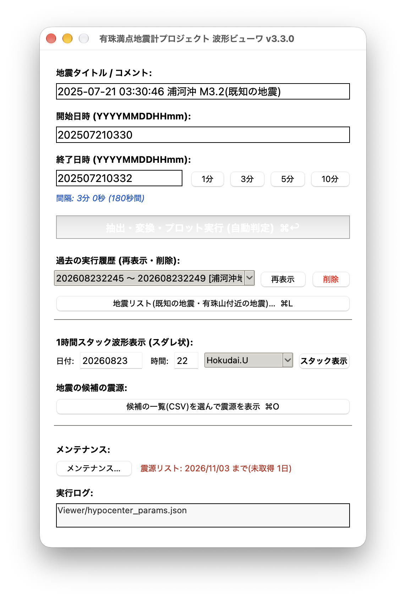

アプリを起動すると開く画面です。上から次の操作が並んでいます。

1. **指定期間の波形表示**：タイトル・開始日時・終了日時を入れて「抽出・変換・プロット実行」（⌘↩）を押します。
2. **過去の実行履歴**：表示した期間を選んで「再表示」します。不要な履歴は「削除」します。
3. **地震リスト**：「地震リスト（既知の地震・有珠山付近の地震）…」（⌘L）で開きます。
4. **1時間スタック波形表示**：日付・時・拠点・成分を選んで表示します。
5. **地震の候補の震源**：「候補の一覧(CSV)を選んで震源を表示」（⌘O）で開きます。
6. **メンテナンス**：「メンテナンス…」で開きます。横に、気象庁の震源リストを取得済みの最後の日が出ます（取得していない日があれば赤字）。
7. **実行ログ**：処理の経過やエラーが出ます。

### 2.1 日時の入れ方

日時は `YYYYMMDDHHmm`（年月日時分の12桁）で入れます。例: 2026年8月23日 22時45分 → `202608232245`。終了の分も表示に含みます。1日以上の期間を指定すると、時間がかかることを確かめるメッセージが出ます。

### 2.2 データの読み込み

指定した期間の日の ZIP（`daily_zips`）が手元に無ければ、Googleドライブから自動でダウンロードします（途中で中止もできます）。取り出した波形はキャッシュ（`output`）に残し、同じ期間は次からすぐに表示します。

---

## 3. 指定期間の波形表示

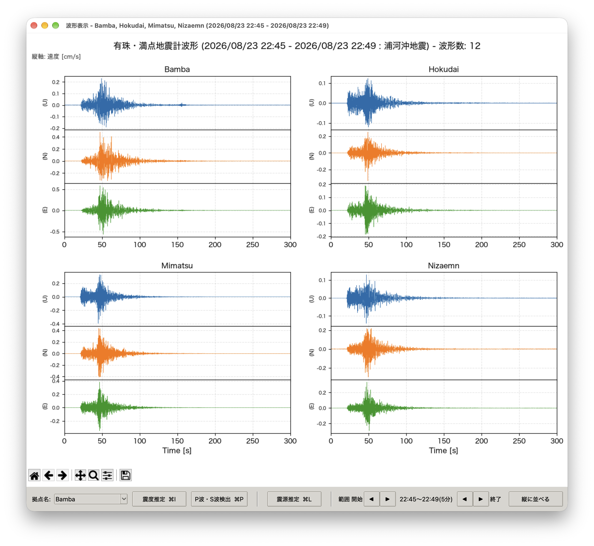

全拠点・全成分（U：上下動、N・E：水平動）の波形を表示します。縦軸は速度（cm/s）です。

- 4拠点そろっているときは拠点ごとの 2×2 表示になります。右下のボタンで、縦に並べる表示と切り替えられます。
- 上のツールバーで、拡大・移動・画像の保存ができます。
- 表示した期間は履歴に残ります（地震リストから開いたときと、範囲を広げたときは残しません）。

### 3.1 表示の範囲を1分ずつ動かす

画面の下の「範囲 開始 ◀ ▶ 22:45〜22:49(5分) ◀ ▶ 終了」で、開始・終了を1分ずつ動かせます。

| キー | 操作 |
|---|---|
| ⌘[・⌘] | 終了を1分前・後へ |
| ⌘⇧[・⌘⇧] | 開始を1分前・後へ |

読み込んだ範囲の外へ広げるときは、その範囲の波形を用意します。震度推定・P波・S波検出・震源推定は、今の範囲の波形を使います。前に入った大きな雑音を外したいときなどに使います。

### 3.2 震度推定（⌘I）

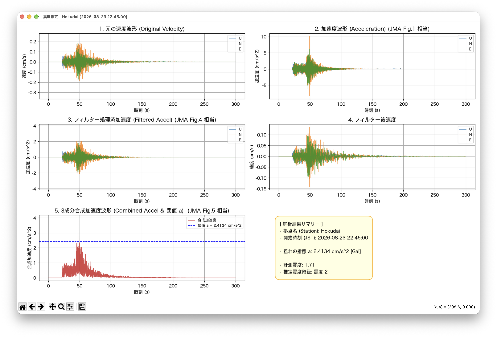

選んだ拠点の3成分から、気象庁の方法で計測震度と震度階級を計算します。途中経過（加速度波形・フィルター後の波形・3成分合成加速度など）もグラフで出ます。⌘W で閉じると、元の波形表示に戻ります。

### 3.3 P波・S波検出（⌘P）

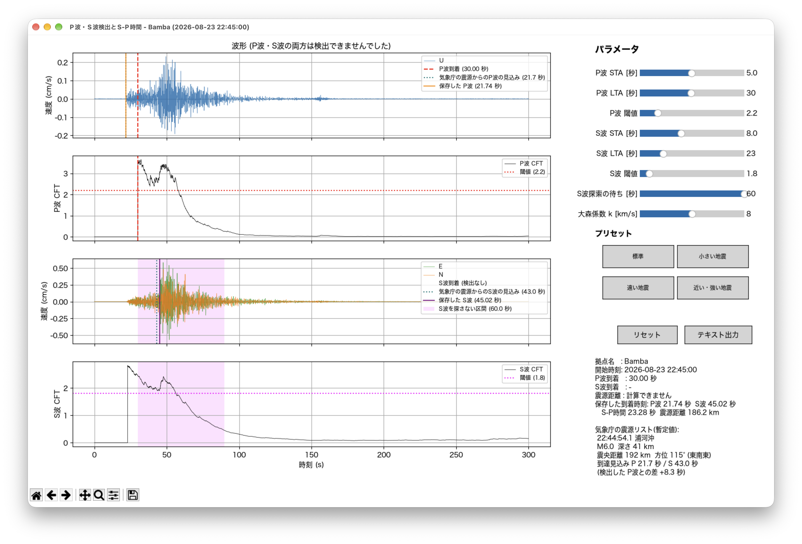

STA/LTA 法で P波・S波の到着時刻を検出し、S-P時間と大森公式から震源までの距離を推定します。S-P時間が5秒以上のときは、走時表から求めた震央距離も出します（「[遠い地震の距離](#far-distance)」）。

- スライダーとプリセットでパラメータを調整できます。設定は次回に引き継がれます。
- 気象庁の震源リストに合う地震があれば、震央地名・M・深さ・距離と、P波・S波の到達見込み（波形に点線）を出します。

### 3.4 震源推定（⌘L）

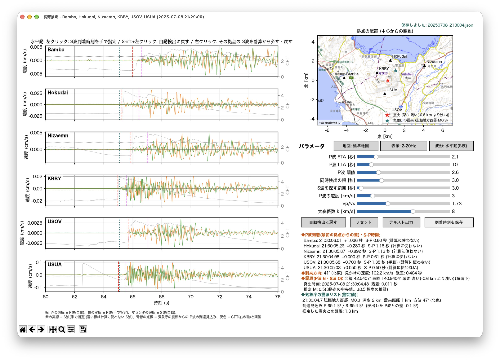

3拠点以上の波形があれば開けます。P波・S波の到着時刻から、震源の位置（緯度・経度・深さ）・発生時刻・推定 M を求め、拠点の配置図（地理院地図）と断面図に示します。

**到着時刻の手直し**

| 操作 | 内容 |
|---|---|
| U・H | 波形の表示を上下動（P波）・水平動（S波）に切り替え |
| 波形をクリック | その位置を到着時刻にする（上下動は P波、水平動は S波） |
| Shift+クリック | その拠点を自動の検出に戻す |
| 右クリック | その拠点（水平動では、その拠点の S波）を計算から外す・戻す |
| ⌘S（到着時刻を保存） | 到着時刻とパラメータを保存する |

保存した到着時刻は、同じ地震を開いたとき（この画面・P波・S波検出・地震の候補の震源）に使われます。「自動検出に戻す」で自動の検出に戻せます。

**結果の見方**

- 深さは、残差がほぼ同じになる範囲も出します（例: 「1.7 km（1.0〜2.4 km）」）。
- 残差が 0.15 秒を超えるときは、遠い地震か検出のずれの可能性があるので注意を出し、配置図の震央を白抜きにします。
- 遠い地震（震源推定の範囲の外や、残差が大きいとき）は、P波の到来方向と S-P時間から震央を推定します。手順は次の「遠い地震を確かめる」を参照してください。
- 推定 M は、拠点ごとに渡辺の式で求め、拠点ごとの補正を引いた値の中央値です（ばらつき ±0.5 程度）。震源距離が 200 km を超える地震では求めません。
- Bamba の S波は、最初は計算に使いません（雑音が多いため）。右クリックで使えます。

#### 遠い地震を確かめる

拠点の間隔が数 km しかないため、遠い地震は到着時刻だけでは位置が決まりません。P波の到来方向と、S-P時間から求めた距離で震央を推定します。自動の検出では、S波を P波の揺れの中の別の変化と取り違えやすいので、S波は手で指定してください。

1. 「S波を探す範囲」を、S-P時間の見込みより長くします（震央距離 200 km 前後なら 30 秒、700 km なら 60 秒）。気象庁の震源リストに合う地震があれば、結果の欄の「到達見込み P … / S …」の差が S-P時間の見込みです。
2. 「波形: 上下動(P波)」で、各拠点の P波の立ち上がりを確かめます。ずれていればクリックで直します。
3. H で水平動の表示にします。
4. 上のツールバーのパン（十字の矢印）を選び、波形の上で**右ドラッグ**して横軸を拡大し、左ドラッグで S波の見込みのあたりに表示を合わせます。遠い地震の S波は、P波の揺れが続く中で、振幅が一段大きくなり、揺れの周期が長くなるところです。
5. パンをもう一度押して解除し、各拠点の S波の立ち上がりをクリックします。拠点ごとの S-P時間がそろっているか確かめます。
6. 結果の欄の「遠い地震として」の震央距離と、震源リストとの「距離の差」「到来方向との差」を確かめ、⌘S で保存します。

#### 遠い地震の距離 {#far-distance}

距離は、ふだんは**走時表**（標準的な地球の速度構造 iasp91 で計算した、S-P時間と震央距離の表）から求めます。震源の深さは分からないので、30 km と仮定しています。パラメータの「距離: 走時表」のボタンを押すと「距離: 大森公式(k)」に変わり、大森公式（距離 = k × S-P時間）で求めます（k はスライダーで変えます）。

大森公式の k は、距離が遠いほど大きくなります。大森公式で確かめるときの目安です（iasp91 から計算。k は震源距離 ÷ S-P時間）。

| 震央距離 | S-P時間（深さ 10 km） | k（深さ 10 km） | k（深さ 50 km） |
|---|---|---|---|
| 150 km まで | 19 秒まで | 8.0 | 8.9〜9.2 |
| 200 km | 24 秒 | 8.4 | 9.3 |
| 300 km | 34 秒 | 8.9 | 9.5 |
| 500 km | 53 秒 | 9.4 | 9.7 |
| 730 km | 76 秒 | 9.6 | 9.9 |

- 例: 2026/8/23 02:00 の茨城県南部の地震（震央距離 730 km）は、S-P時間 73.5 秒から、走時表で 718 km、k = 9.0 の大森公式で 661 km になります。
- 遠い地震の推定 M は、走時表の震源距離（震央距離と深さ 30 km から）で求めます。

---

## 4. 過去の実行履歴

メイン画面の「過去の実行履歴」のプルダウンから期間を選び、「再表示」で波形を表示します。履歴は 1000 件まで残ります。地震の候補を探すときに「候補の履歴への追加」を選ぶと、候補の期間もまとめて履歴に入ります。

---

## 5. 1時間スタック波形

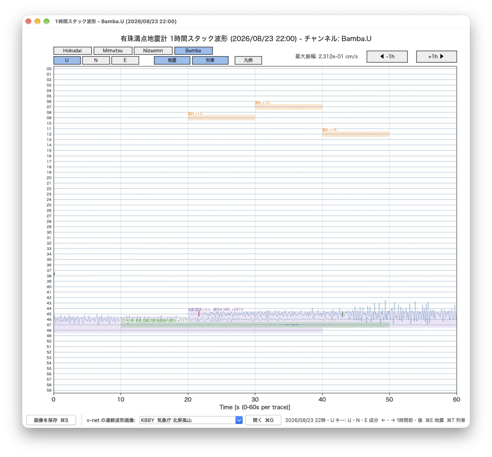

1時間分の波形を1分ずつ60段に並べて表示します。メイン画面で日付（`YYYYMMDD`）・時・拠点・成分を選んで開きます。

| 操作 | 内容 |
|---|---|
| ←・→ | 1時間前・後へ |
| U・N・E | 成分の切り替え |
| ホイール・ドラッグ | 横軸の拡大・横移動 |
| 波形を右クリック | その分から 1〜30 分間の全拠点の波形表示を開く |
| ⌘E・⌘T | 「地震」「列車」の重ね表示の切り替え |
| ⌘S | 表示中の1時間を画像（PNG・PDF・SVG）で保存 |
| ⌘G | v-net の連続波形画像（防災科研のページ）をブラウザで開く |

### 5.1 重ね表示

- **地震**：地震の候補を帯で示します（紫＝気象庁の震源リストと照合できたもの、桃色＝照合できないもの）。震源リストの地震の P波・S波の到達見込みを縦線で示します。地震の候補を探していない日は、左下にその旨が出ます。
- **列車**（Bamba だけ）：洞爺駅の時刻表と対応した列車の揺れ・貨物列車の候補を帯と ▼ で示します。時刻表（`train_timetable.csv`）は各自で用意します（「[10.3 洞爺駅の時刻表](#timetable)」）。

色の説明は「凡例」ボタンで出ます。保存した画像には、下に色の説明が入ります。

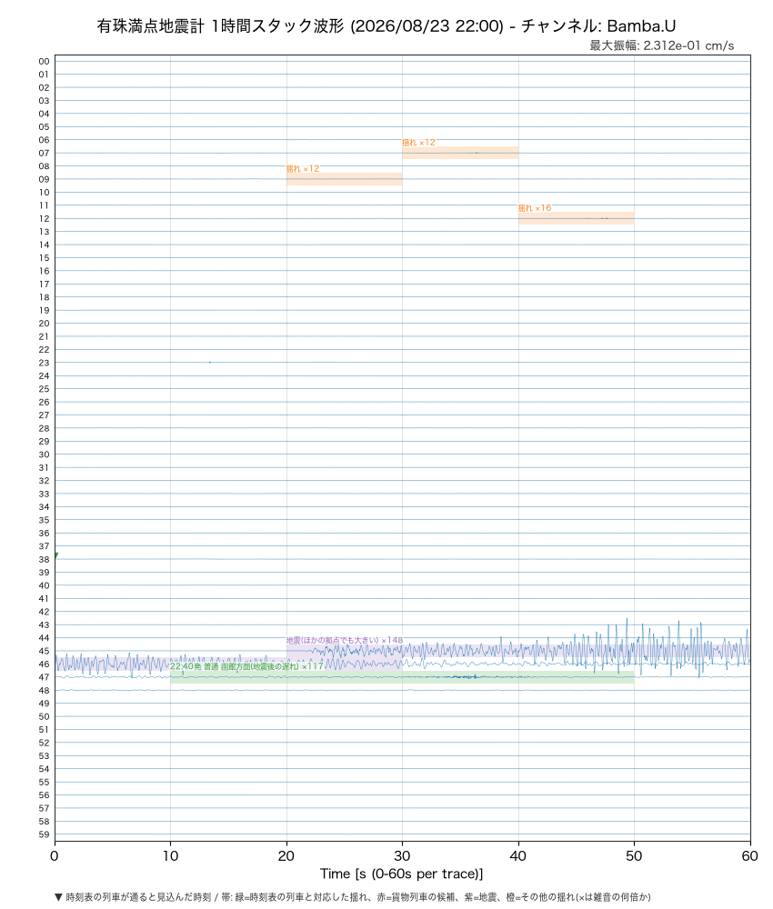

### 5.2 ほかの機関の連続波形画像

操作エリアの「v-net の連続波形画像」で観測点を選んで開くと、表示中の1時間・成分の連続波形画像を防災科研のページで見られます。満点の拠点では雑音にまぎれる揺れを、ほかの機関の観測点でざっと確かめるのに使います。

---

## 6. 地震リスト

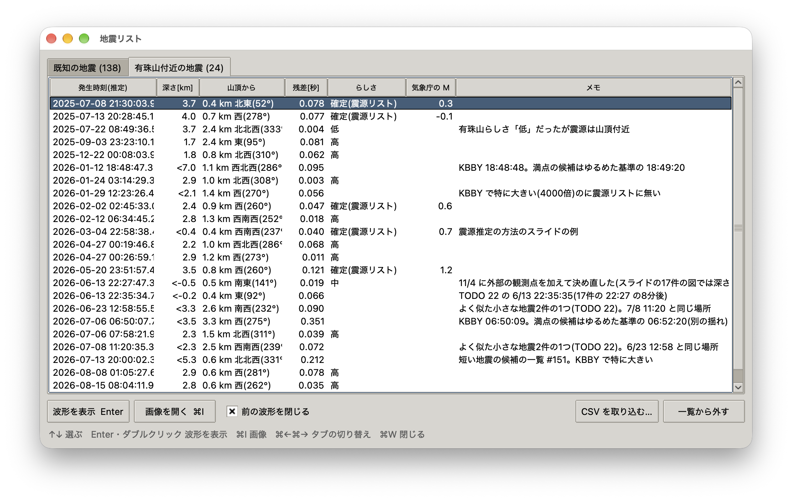

既知の地震と有珠山付近の地震の波形を、一覧から選んですぐに確かめる画面です（⌘L）。

- **既知の地震**：気象庁の震源リストと対応した地震の候補です。地震の候補を探すと、自動で加わります。
- **有珠山付近の地震**：満点の観測点で震源を求めた地震です。地震の候補の震源の画面（⌘U）か、CSV の取り込みで加えます。
- 両方に当てはまる地震は両方に入り、既知の地震の「有珠山付近」の列に ○ が付きます。

| 操作 | 内容 |
|---|---|
| ↑↓ | 地震を選ぶ |
| Enter・ダブルクリック | 選んだ地震の波形を表示（揺れの30秒前から30秒後まで） |
| ⌘I | 確認用の画像を開く |
| ⌘←・⌘→ | タブの切り替え |
| 列の見出しをクリック | その列で並べ替え（もう一度で逆順） |
| ⌘W | 閉じる |

- 開いた波形の画面が前に出ます。波形の画面を閉じると、地震リストに戻ります。
- 「前の波形を閉じる」に印があると、次の地震を開くときに前の波形の画面を閉じます。続けて見ていくときに便利です。
- 「一覧から外す」で外した地震は、候補を探し直しても自動では戻りません（その地震を含む CSV を自分で取り込むと戻ります）。
- 「CSV を取り込む…」で、地震の候補の一覧・震源の一覧からまとめて加えたり、直したりできます。同じ地震は置き換わり、CSV で空の値は前の値が残ります。

---

## 7. 地震の候補の震源

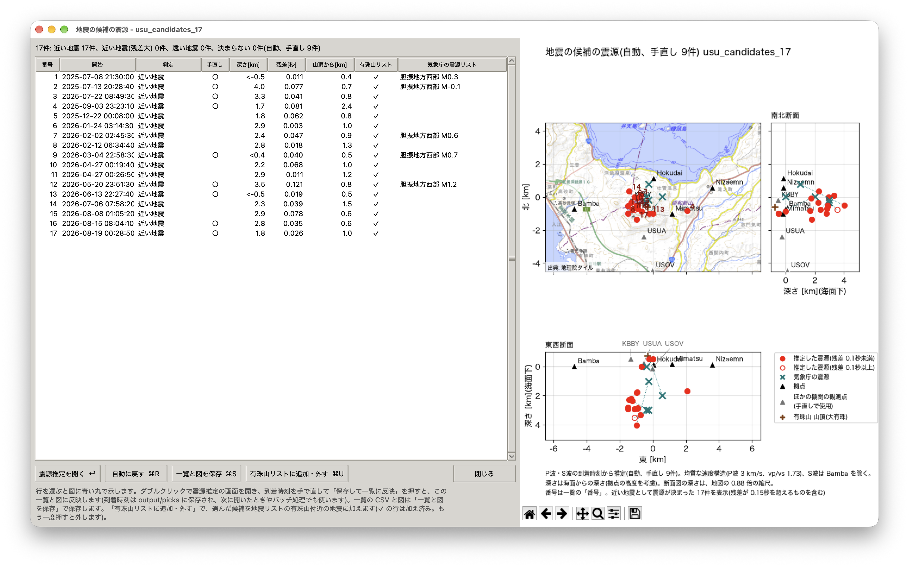

地震の候補の一覧（CSV）を選ぶと、候補ごとに震源を求め、結果の表と震央の地図・東西と南北の断面図を並べて表示します（⌘O）。

- 一覧に「候補」の列があれば、その列に何か書いてある行だけを使います（Excel で印を付けて CSV に保存したもの）。
- 判定は「近い地震」「近い地震(残差大)」「遠い地震」「決まらない」の4つです。
- 表の行を選ぶと、地図と断面図に青い丸で示します。

| 操作 | 内容 |
|---|---|
| Enter・ダブルクリック | 選んだ候補の震源推定の画面を開く（到着時刻を手で直せる） |
| ⌘U | 選んだ候補を有珠山リストに加える・外す |
| ⌘R | 保存した到着時刻を消して、自動に戻す |
| ⌘S | 一覧（CSV）と図（PNG・SVG）を保存 |
| ⌘W | 閉じる |

- 震源推定の画面で「保存して一覧に反映」を押すと、直した到着時刻で求め直した震源が、表と図に反映されます（「手直し」の列に ○）。
- 「有珠山リスト」の列の ✓ は、地震リストの有珠山付近の地震にある候補です。

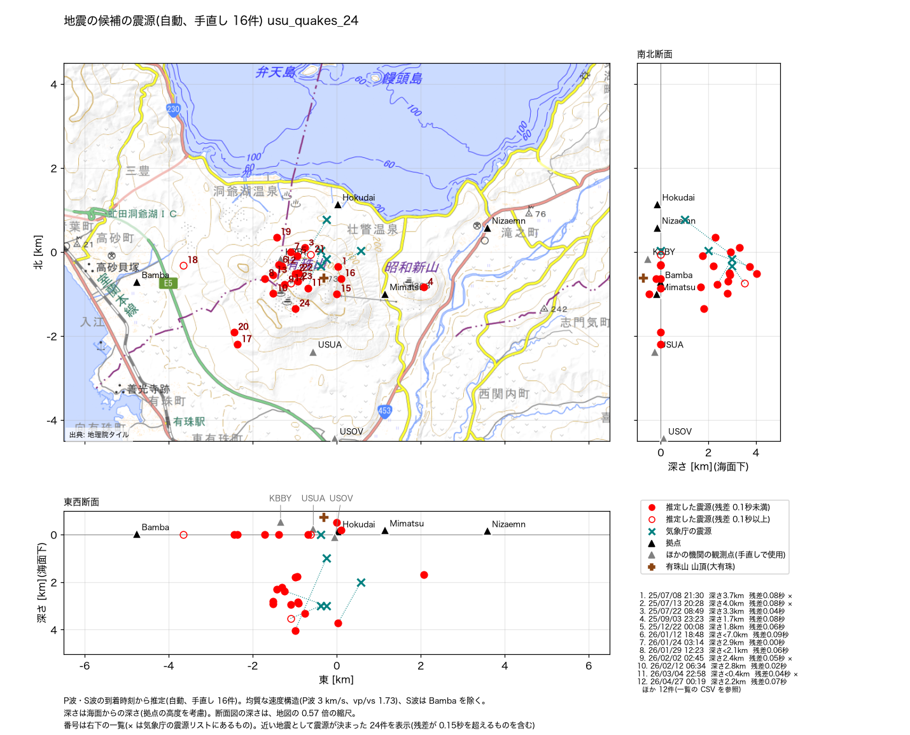

---

## 8. メンテナンス画面

メイン画面の「メンテナンス…」で開きます。項目ごとのタブに分かれています。下の実行ログに経過が出ます。時間のかかる処理は途中で中止できます。

### 8.1 震源リスト

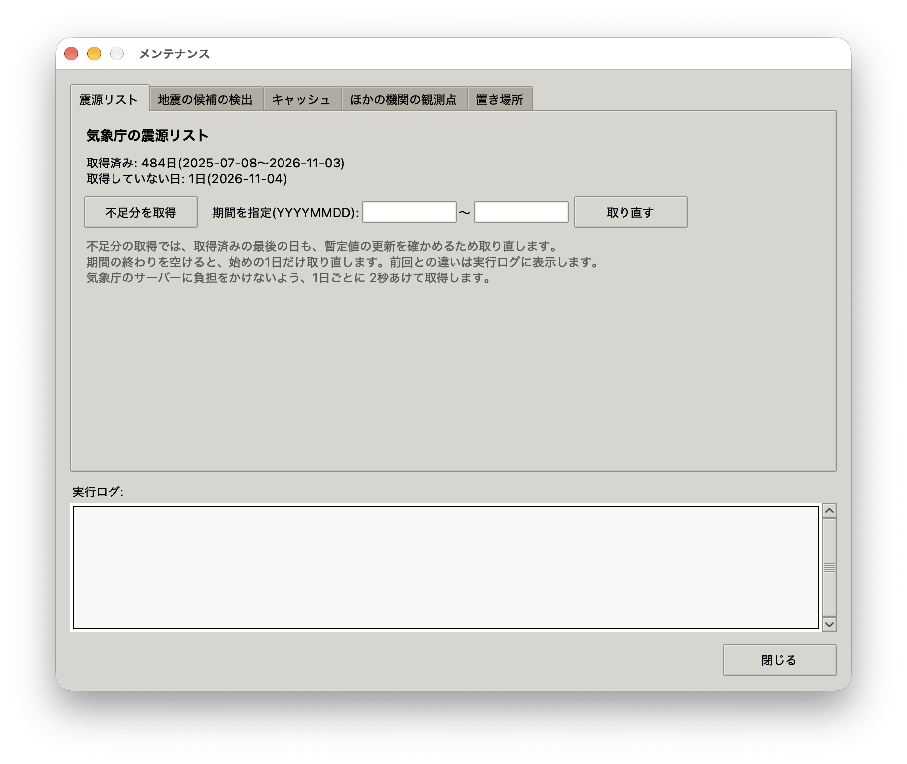

気象庁の震源リスト（日ごと・暫定値）を取得します。地震の候補との照合・到達見込みに使います。

- **不足分を取得**：まだ取得していない日を取得します。取得済みの最後の日も、暫定値の更新を確かめるため取り直します。
- **取り直す**：期間（`YYYYMMDD`）を入れて押すと、取得済みの日も取り直します。

### 8.2 地震の候補の検出

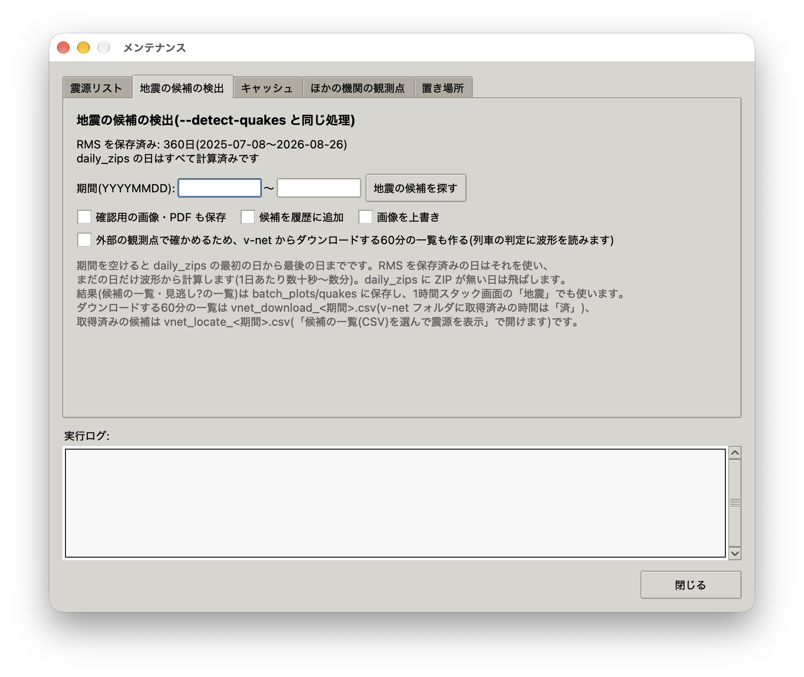

記録から地震らしい揺れ（3拠点以上が同時に雑音の20倍を超えたもの、または山頂に近い Hokudai が大きく揺れたもの）を探し、気象庁の震源リストと照合します。

- 期間（`YYYYMMDD`）を空けると、`daily_zips` の全期間です。揺れの大きさ（RMS）を計算済みの日は、それを使うので速く終わります。
- 選べるもの：確認用の画像・PDF の保存、候補の履歴への追加、外部の観測点で確かめるためにダウンロードする60分の一覧の作成。
- 結果は `batch_plots/quakes` に保存します（`quake_candidates_<開始日>_<終了日>.csv` など）。震源リストと対応した候補は、地震リストの既知の地震に加わります。
- 手元の `daily_zips` だけを使います（Googleドライブからはダウンロードしません）。

候補には「有珠山の地震らしさ」（確定(震源リスト)・高・中・低）が付きます。確認用の画像は次のような形です。

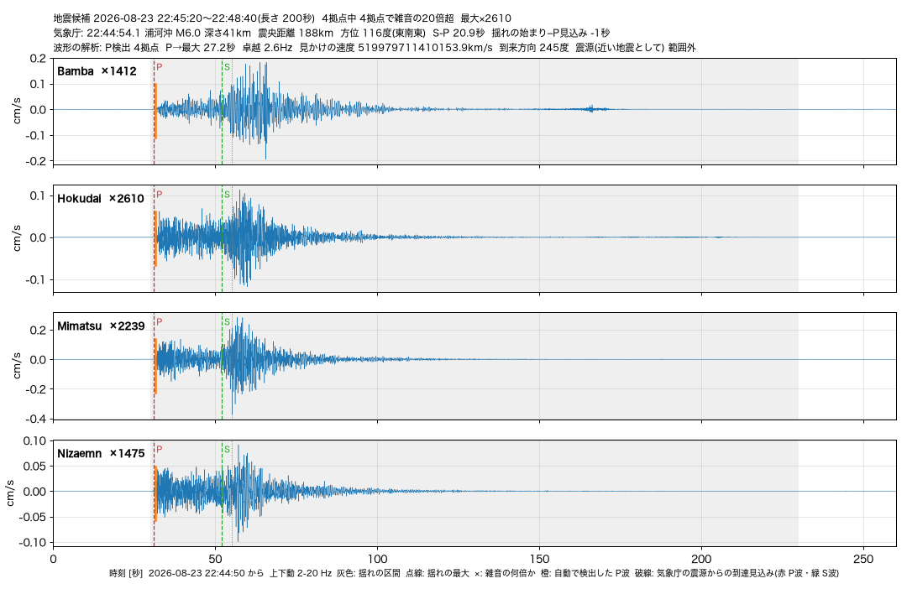

### 8.3 キャッシュ

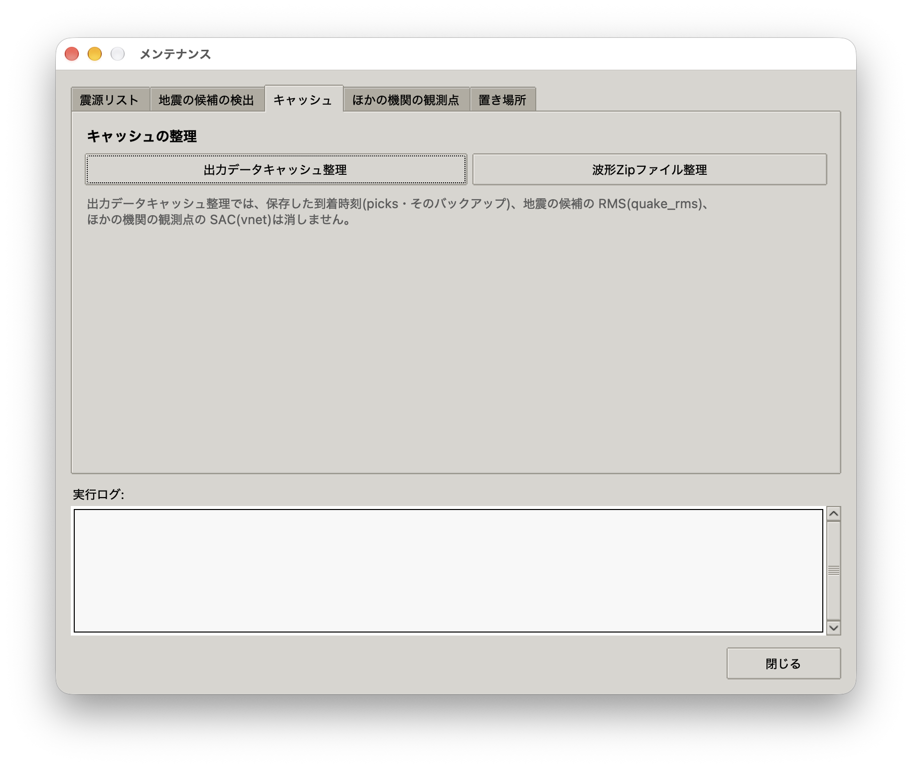

- **出力データキャッシュ整理**：期間ごと・1時間ごとに作った WIN・SAC ファイルを、種類ごとに消します（`daily_zips` から作り直せます）。保存した到着時刻・RMS などは消しません。
- **波形Zipファイル整理**：`daily_zips` の ZIP を消します（必要になれば Googleドライブからダウンロードし直します）。

### 8.4 ほかの機関の観測点 {#external}

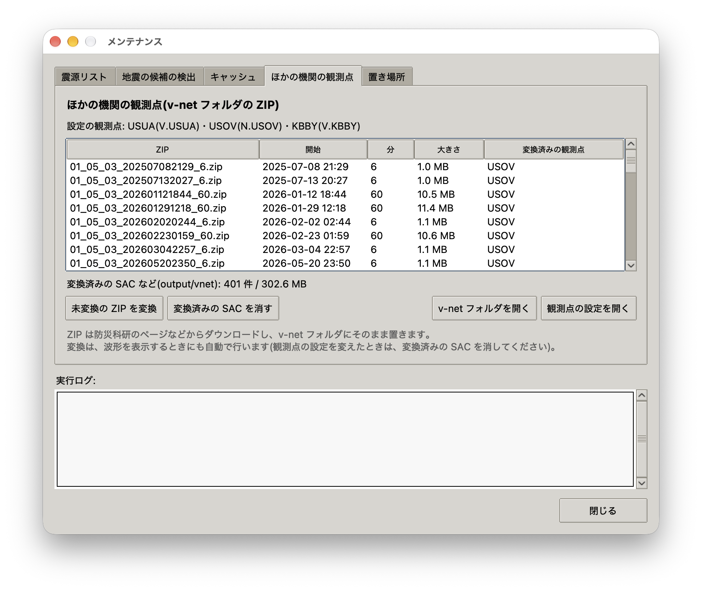

気象庁・防災科研の観測点の波形（`v-net` フォルダの ZIP）を一覧にします。まだ変換していない ZIP の変換、変換済みのファイルの削除、`v-net` フォルダと観測点の設定ファイルを開くことができます。

- ZIP は防災科研のページなどから手でダウンロードし、`v-net` フォルダにそのまま置きます。
- **再配布できません**（防災科研・気象庁のデータ）。人に渡したり公開したりしないでください。

### 8.5 置き場所 {#paths}

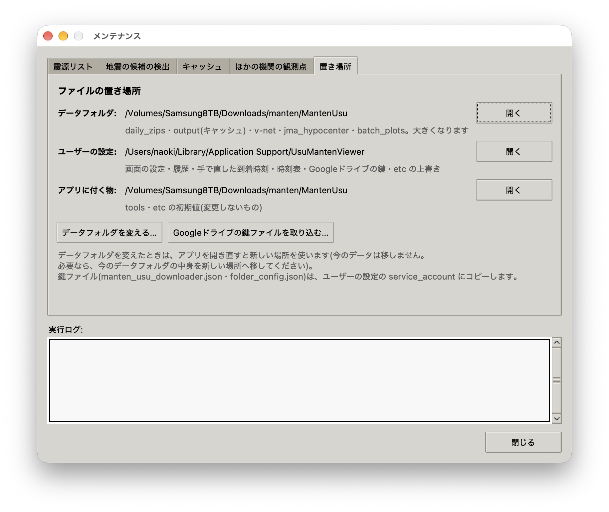

アプリが使うフォルダの場所を表示し、「開く」でそのフォルダを開きます。

- **データフォルダを変える…**：大きいデータ（`daily_zips`・キャッシュなど）を置くフォルダを変えます。アプリを開き直すと新しい場所を使います（今のデータは移しません）。
- **Googleドライブの鍵ファイルを取り込む…**：受け取った鍵ファイルを、ユーザーの設定にコピーします。

---

## 9. 地震リストの管理の流れ

地震リストを作り、データが増えたら足していく流れです。

### 9.1 はじめて作るとき

**① 気象庁の震源リストを取得する**
メンテナンス画面の「震源リスト」で「不足分を取得」を押します。照合は取得済みの分だけを使うので、候補を探す前に済ませます。

**② 地震の候補を探す**
メンテナンス画面の「地震の候補の検出」で期間を入れて実行します。確認用の画像も保存しておくと、地震リストで画像を開けます。震源リストと対応した候補は、地震リストの**既知の地震**に自動で加わります。

**③ 有珠山付近の候補を確かめる**

1. `quake_candidates_*.csv` を Excel で開き、「候補」の列を足して、確かめる行（らしさが「確定(震源リスト)」「高」「中」など）に印を付け、CSV で保存します。
2. その CSV を ⌘O で開き、判定・深さ・残差・山頂からの距離と、地図・断面図を見ます。
3. 怪しい行はダブルクリックで震源推定の画面を開き、到着時刻を直して「保存して一覧に反映」を押します。
4. 有珠山付近の地震と判断したら ⌘U で**有珠山リスト**に加えます（✓ が付きます）。
5. ⌘S で、震源の一覧と図を残します。

**③' 満点だけでは拾えない小さな地震**
② で「外部の観測点で確かめる60分の一覧」も作ります。`vnet_kbby_*.html` をブラウザで開いて揺れのある候補を絞り、その60分の波形を防災科研のページからダウンロードして `v-net` フォルダに置きます。もう一度候補を探すと、波形のそろった候補が `vnet_locate_*.csv` になるので、③ と同じように ⌘O で開いて確かめ、⌘U で加えます。

**④ 地震リストを整える**
⌘L で両方のタブの波形と画像をひととおり見て、地震でなかったものは「一覧から外す」で外します。メモなどをまとめて直すときは、CSV を直して取り込みます。

### 9.2 データが増えたとき

**データを用意する側**（拠点ごとの元の ZIP を受け取ったとき）

1. 元の ZIP を、データフォルダの `source_zips` に置きます（データフォルダの場所は、メンテナンス画面の「置き場所」で確かめられます）。
2. `repackage_to_daily_zip.py` で、日ごとの ZIP（`YYMMDD.zip`）にまとめ直します。データフォルダの `daily_zips` に書き、同じ日の ZIP がすでにあれば、無い WIN ファイルだけを書き足します。
3. 新しくできた日と、書き足した日の ZIP を、Googleドライブのフォルダに保存します（同じ名前のファイルは置き換えます）。

使う側の `--download-zips` は、手元の ZIP の大きさがドライブと違う日（あとから書き足された日）もダウンロードし直します。

**使う側**

1. 新しい日の ZIP を Googleドライブからまとめてダウンロードします（「[10.1 バッチ処理](#batch)」の `--download-zips`）。
2. 震源リストの「不足分を取得」で、新しい日まで取得します。
3. 地震の候補の検出で、新しい期間を探します（計算済みの日は使い回すので、全期間を指定しても新しい日の分だけ計算します）。既知の地震は自動で増えます。
4. 新しい候補の一覧に印を付けて ⌘O で開き、⌘U で有珠山リストに加えます（9.1 の ③・③'）。
5. 地震リストで、増えた分を確かめます（9.1 の ④）。

---

## 10. そのほか

### 10.1 バッチ処理（コマンドで実行する処理） {#batch}

画面を出さずに、まとめて処理します。プロジェクトのフォルダで実行します（Windows は `python scripts\UsuMantenViewer.py …`）。

| コマンド | 内容 |
|---|---|
| `python3 scripts/UsuMantenViewer.py --download-zips -s 20260901 -e 20260930` | 手元に無い日の ZIP を Googleドライブからまとめてダウンロード（`--dry-run` で件数と大きさだけ表示） |
| `python3 scripts/UsuMantenViewer.py --detect-quakes -s 20260801 -e 20260831 --images` | 地震の候補を探して震源リストと照合（メンテナンス画面と同じ） |
| `python3 scripts/UsuMantenViewer.py --locate-quakes <候補の一覧.csv> --images` | 候補の一覧から震源を求め、一覧と図を保存 |
| `python3 scripts/UsuMantenViewer.py --batch -c Hokudai.U -s 20260801 -e 20260831` | 1時間スタック波形の画像をまとめて保存（`--quakes`・`--trains` で重ね表示） |

### 10.2 ファイルの置き場所

| 種類 | 中身 | 場所（Mac / Windows） |
|---|---|---|
| アプリに付く物 | 外部ツール、設定ファイルの初期値 | アプリの中 |
| ユーザーの設定（小さい・作り直せない） | 画面の設定、実行履歴、地震リスト（`quake_lists.json`）、手で直した到着時刻、時刻表、Googleドライブの鍵 | `~/Library/Application Support/UsuMantenViewer` / `%APPDATA%\UsuMantenViewer` |
| データフォルダ（大きい） | `daily_zips`、`source_zips`（データを用意する側だけ）、キャッシュ（`output`）、`v-net`、震源リスト、`batch_plots` | メンテナンス画面の「置き場所」で確認・変更 |

### 10.3 洞爺駅の時刻表 {#timetable}

列車の重ね表示・照合に使う時刻表（`train_timetable.csv`）は、JR の時刻表から各自で作ります。**再配布できません。**

- 入力用のひな形 `train_timetable_template.xlsx` に入力し、CSV（UTF-8）で保存して、ユーザーの設定の `etc` フォルダに置きます。
- ダイヤ改正のときは、各行の「有効開始日」「有効終了日」で、その行を使う期間を指定します（空けると期限なし）。

### 10.4 困ったとき

| 症状 | 確かめること |
|---|---|
| 起動に時間がかかる | 最初の1回は数十秒〜1分半ほどかかります（「[1.5 アプリを使い始める](#start)」） |
| Mac で起動しない・波形が出ない | 隔離情報を外したか（「[1.5 アプリを使い始める](#start)」の `xattr` のコマンド） |
| 「ZIPファイルが見つかりません」・ダウンロードできない | Googleドライブの鍵ファイルがあるか（メンテナンス画面の「置き場所」）。インターネットにつながっているか |
| 1時間スタック波形の「地震」で候補の帯が出ない | その日の地震の候補を探したか（メンテナンス画面の「地震の候補の検出」） |
| 照合・到達見込みが出ない | その日の震源リストを取得したか（メイン画面の「メンテナンス…」の横の表示） |
| 「列車」が使えない | 時刻表がユーザーの設定の `etc` にあるか。表示中の拠点が Bamba か |
| 地震リストの「画像を開く」で画像が無い | 地震の候補を探すときに「確認用の画像」を保存したか |
| 地図の背景が出ない | インターネットにつながっているか（地理院タイルを使います。一度取得したタイルは保存します） |

### 10.5 キーボード操作の一覧

| 画面 | キー | 操作 |
|---|---|---|
| メイン画面 | ⌘↩ | 抽出・変換・プロット実行 |
| | ⌘O | 候補の一覧(CSV)を選んで震源を表示 |
| | ⌘L | 地震リストを開く |
| 指定期間の波形表示 | ⌘I・⌘P・⌘L | 震度推定・P波・S波検出・震源推定 |
| | ⌘[・⌘]、⌘⇧[・⌘⇧] | 表示の範囲の終了・開始を1分ずつ動かす |
| 震源推定 | U・H | 上下動・水平動の切り替え |
| | ⌘S | 到着時刻を保存 |
| 1時間スタック波形 | ←・→、U・N・E | 1時間前・後、成分の切り替え |
| | ⌘E・⌘T・⌘S・⌘G | 地震・列車の重ね表示、画像を保存、v-net の連続波形画像 |
| 地震リスト | Enter・⌘I・⌘←⌘→ | 波形を表示、画像を開く、タブの切り替え |
| 地震の候補の震源 | Enter・⌘U・⌘R・⌘S | 震源推定を開く、有珠山リスト、自動に戻す、保存 |
| どの画面でも | ⌘W | 閉じる（開いた元の画面に戻ります） |

U・N・E などの修飾キーなしのキーは、文字を入力する欄を選んでいるときは効きません。
